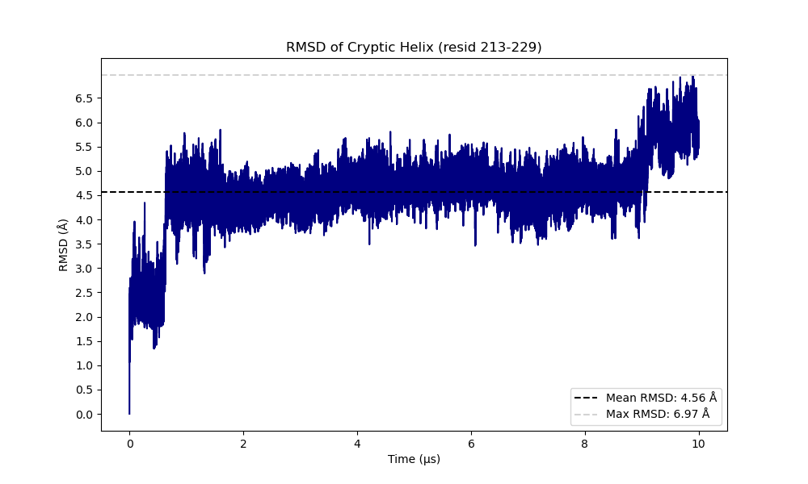
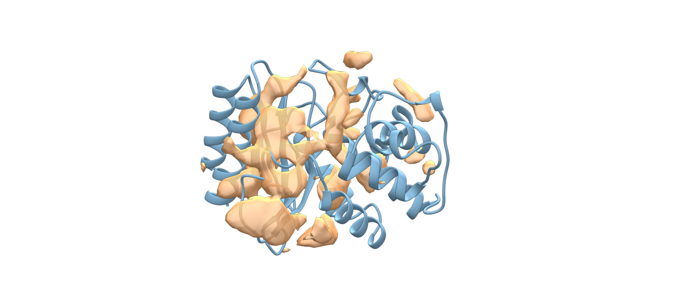
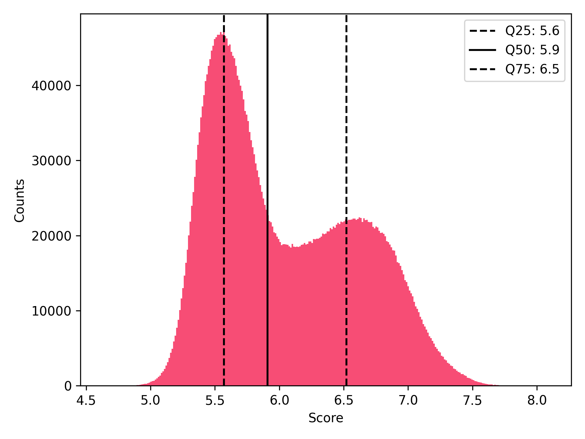
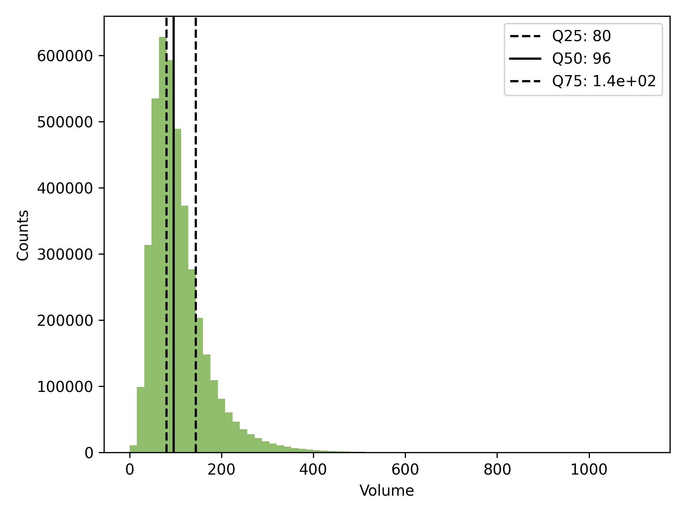
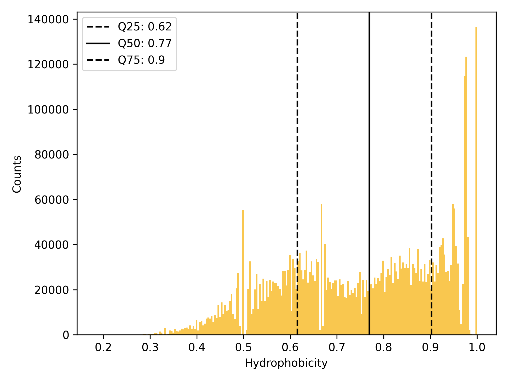
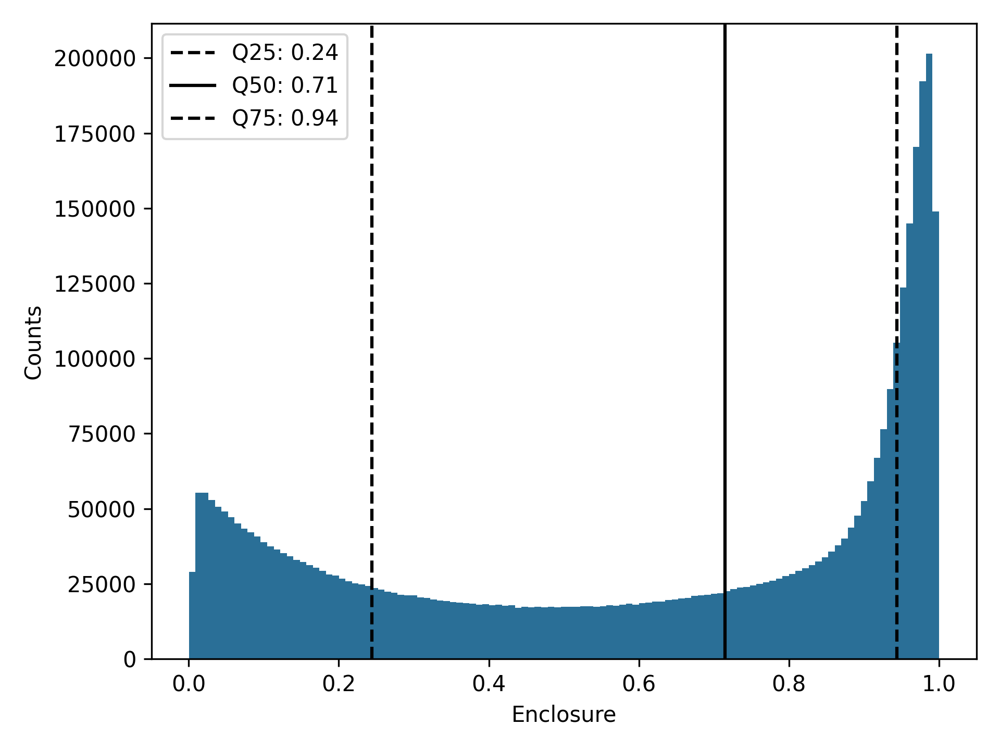

=========
Tutorials
=========

Background
----------

Cryptic pockets are transient cavities in proteins that can be revealed by local structural fluctuations or binding with small molecules. These regions are typically far from the catalytic site. Computational approaches, such as mixed-solvent molecular dynamics simulations, enhanced sampling, and pocket prediction tools, can be used to detect cryptic pockets. They can also be detected experimentally through biophysical techniques, such as X-ray crystallography. :cite:`bemelmans2025computational, vajda2018cryptic, mou2025discovery`

TEM-1 beta-lactamase is an example of a protein that reveals cryptic pockets when simulated in a mixed solvent. :cite:`bemelmans2025computational` Nevertheless, these pockets have also been observed through crystallography experiments. :cite:`vajda2018cryptic, horn2004allosteric`

In order to test the ability of Poké to capture the appearance of cryptic pockets in proteins, we simulated TEM-1 beta lactamase in mixed-solvent. Among the multiple TEM apo structures available in Protein Data Bank, we chose PDB ID 1LI9 (1.5 Å resolution) for our purpose. The simulations were performed with GROMACS. First, we placed the protein in a simulation box of 7.6 x 7.6 x 7.6 nm. Then, we solvated the system with the TIP3P water model and neutralized it with a 150mM concentration of NaCl. Then, to generate the mixed-solvent we added a 30mM concentration of Benzene. The protein and the benzene have been parameterized with the CHARMM36 force field. 
The system was equilibrated at physiological conditions of pressure (1 atm) and temperature (37°C) using an NPT ensemble. Then, the productive run was carried out at constant pressure and temperature for a total simulation time of 10 µs. 
The opening of the cryptic pocket has been also monitored through RMSD.

Pocket inspection with poké
---------------------------

Loading files:
''''''''''''''

The test files we will be working with feature the 10 µs trajectory of TEM protein in mixed solvent: ``ref.gro`` is the structure file from which we will be able to load the trajectory file, ``ligands.xtc``.

.. note::

  To avoid visual mismatching between the positions of the benzene molecules and the pockets detected, we recommend applying a periodic-boundary-condition (PBC) correction to the positions of the ligands in the trajectory.

Calculation of the distribution of pockets in the protein and distribution of pocket properties.
''''''''''''''''''''''''''''''''''''''''''''''''''''''''''''''''''''''''''''''''''''''''''''''''

We define a ``density grid`` with the volume points of the pockets inspected in TEM protein.

.. code-block:: bash

   poke ref.gro ligands.xtc -dx -ss protein -a protein -so protein --sort score -ls -o density_inspection_all

The results are returned as a NumPy array stored in ``density.dx`` and ``density.mrc``. The first format (``density.dx``) is a text-based file containing structured blocks of information: grid origin and spacing, number of grid points and the actual density values. This format is easily readable with PyMol.
The second format (``density.mrc``) contains  density point information in binary format. The file consists of a header that stores the grid size, origin, voxel spacing, map statistics, and data type. This format type is more suitable for Chimera, though it can also be parsed by PyMol.

.. code-block:: bash
    
    poke ref.gro ligands.xtc -dg -ss protein -a protein -so protein --sort score -ls -o histograms_all

Inspection of pocket volumes of the best 1000 pockets 
'''''''''''''''''''''''''''''''''''''''''''''''''''''

.. code-block:: bash
    
    poke ref.gro ligands.xtc -dvp -ss protein -a protein -so all --sort score -ls -o all_best_1000 -n 1000

The output includes ``descriptors.csv``, ``structure.pdb``, ``volumes.pdb``, and a ``pymol.pml`` session file that reads ``structure.pdb`` and ``volumes.pdb`` directly to visualize the pockets.
``Descriptors.csv`` contains parameters that define the inspected pockets, such as the trajectory frame in which they were detected, their score, volume, and hydrophobicity. It also contains information about the residues and atoms that make up the pockets.

.. note:: 

  It is important to mention that Poké can detect multiple pocket conformations within a single trajectory. These conformations can either have a different shape or be an extension of a pre-existing pocket.

An example of two pockets that share the same trajectory frame are shown here:

.. raw:: html

  

    

    

      <h3>Select pocket conformation</h3>
      <label><input type="checkbox" id="p40"> Conformation 1</label> 
      <label><input type="checkbox" id="p462"> Conformation 2</label>  

      <button id="resetView1">Reset view</button>
      

    

  

  
  

Two examples of pockets identified through visual inspection are shown below:

.. raw:: html

  

    

    

      <h3>Select protein conformation</h3>
      <label><input type="checkbox" id="p12"> Conformation 3</label> 
      <label><input type="checkbox" id="p63"> Conformation 4</label>  

      <button id="resetView2">Reset view</button>
      

    

  

  
  

Identification of pockets on the cryptic site
'''''''''''''''''''''''''''''''''''''''''''''

Using PDB ID 1PZO as a reference to understand the position of the cryptic pocket, we identified some pockets in the cryptic area in our simulations. In particular, pockets 15, 26, 31, 34, and 67 of the top 1,000 contain benzene molecules. Using the descriptors.csv file, we extracted the residues common to pockets 15, 26, 31, 34, and 67 that define the cryptic region. We then ran poké again with this residue definition:

Residue definition= [225,290,229,230,231,261,263,250,251,279,248,282,283,221,286,287]

.. code-block:: bash
    
    poke ref.gro ligands.xtc -dg -ss protein -a protein -so all --sort score -ls -f 'len(resids & {225,290,229,230,231,261,263,250,251,279,248,282,283,221,286,287})>6' -o table-common
    # to get the total number of pockets found and the distribution of pocket descriptors.
    poke ref.gro ligands.xtc -dvp -ss protein -a protein -so all --sort score -ls -f 'len(resids & {225,290,229,230,231,261,263,250,251,279,248,282,283,221,286,287})>6'  -n 300 -o table-common
    # to get the best 300 pockets and afterwards do visual inspection of them

.. raw:: html

  

    

    

      <h3>Select protein conformation</h3>
      <label><input type="checkbox" id="p15"> Conformation 5</label> 
      <label><input type="checkbox" id="p26"> Conformation 6</label> 
      <label><input type="checkbox" id="p31"> Conformation 7</label> 
      <label><input type="checkbox" id="p34"> Conformation 8</label> 
      <label><input type="checkbox" id="p67"> Conformation 9</label>  

      <button id="resetView3">Reset view</button>
      

    

  

  
  

Due to benzene scouting, a total of 827,542 pocket conformations were found in the cryptic area. Of these conformations, 157,749 belong to the same trajectory frame. On average, all pocket conformations inspected from the top 300 present a volume of 96 ų, a score of 6.6 a.u., a hydrophobicity of 0.92 a.u., and an Enclosure of 0.95 a.u., meaning that the pockets are quite buried and apolar, as expected.

.. raw:: html

  

    

    

      <h3>Select protein conformation</h3>
      <label><input type="checkbox" id="p9"> Conformation 10</label> 
      <label><input type="checkbox" id="p41"> Conformation 11</label>  

      <button id="resetView4">Reset view</button>
      

    

  

  
  

.. bibliography::
  :filter: docname in docnames