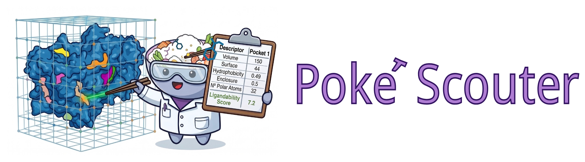

.. poké documentation master file, created by
   sphinx-quickstart on Tue Jul 15 12:04:06 2025.
   You can adapt this file completely to your liking, but it should at least
   contain the root `toctree` directive.

Welcome to Poké documentation
=============================

.. toctree::
   :maxdepth: 2
   :hidden:

   Getting Started
   Descriptors
   Outputs
   Filters
   Structure Preparation
   CLI Reference
   Python Package
   Plugin
   Tutorials

This guide documents Poké |release|.

**Poké scouter** is a blazing fast pocket scouter based on CHARMM forcefield. It uses an energy-based approach to identify the low-energy regions of the protein and it is able to compute a set of descriptors for each pocket useful to characterize it. The descriptors are used then by a neural network model to assign a druggability score to the pocket.

Designed to be used on long molecular dynamics trajectories, but it can be used also on single frames.

**Get Started**

If you are new to Poké, start here:

* :doc:`Getting Started` to install the package and run it on a structure or a trajectory
* :doc:`Tutorials` for a worked example on a cryptic pocket of TEM-1 β-lactamase

**How to cite**

If you use Poké in your research, please cite:

   Colasurdo, E., Boldrini, A., Terruzzi, L., Langini, C., Risueño Fernández, C., Varricchio, C.,
   Primavera, E., Cassese, E., Patsilinakos, A. & Spagnolli, G. *Poké: Fast and Reliable
   Neural-Network-Based Identification of Protein Ligandable Sites.* ACS Omega (2026).
   https://doi.org/10.1021/acsomega.6c04816

**Code and data**

* Source code on GitHub: https://github.com/SibyllaBiotech/poke
* Source code archived on Zenodo: https://doi.org/10.5281/zenodo.19634786
* Datasets used in the paper, on Zenodo: https://doi.org/10.5281/zenodo.19635030

**Licence**

Poké is free software released under the `MIT licence
<https://github.com/SibyllaBiotech/poke/blob/main/LICENSE>`_. The text and figures of this
guide are released under the `CC BY 4.0 <https://creativecommons.org/licenses/by/4.0/>`_ licence.
